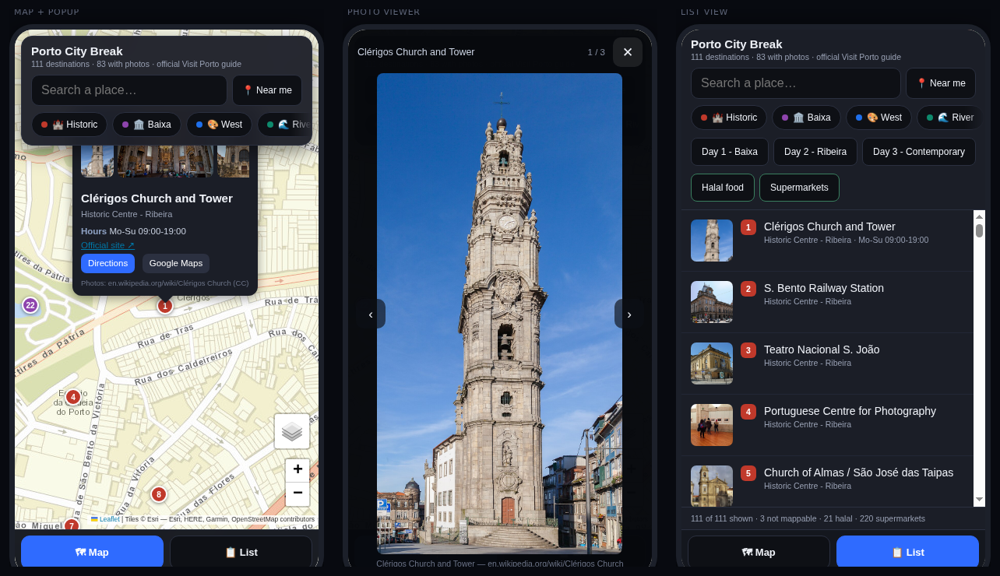

# Porto City Break — interactive map

A single-file, offline-friendly map of **111 Porto destinations** — the official Visit Porto list, geocoded and enriched. Photos, opening hours, websites, halal food and supermarkets, three ready-made day routes, and a phone-first UI.

**Live demo:** `https://hamzafelix.github.io/porto-map-3days/`.



## What's in it

- **111 pinned destinations** across five colour-coded areas (Historic Centre / Ribeira, Baixa, West Porto / Boavista, River and Sea, East Porto), each numbered per area.
- **83 with photographs** (176 images) — hotlinked Wikimedia thumbs, every one validated against the destination's real coordinates so you don't get a photo of the wrong building in the wrong city.
- **28 opening hours + 34 official websites**, matched from OpenStreetMap tags. Clérigos really does say `Mo-Su 09:00-19:00` and links `torredosclerigos.pt`.
- **Photo viewer** — tap any photo for fullscreen: swipe or arrow keys to flip, double-tap to zoom, drag to pan.
- **Halal food (21)** — 5 explicitly tagged `diet:halal=yes`, the other 16 are kebab/Arab/Pakistani places marked *halal-friendly, not certified*. Deliberately not blurred together.
- **Supermarkets (220)** from OSM, off by default.
- **Three day routes** — Day 1 Baixa, Day 2 Ribeira, Day 3 Contemporary — drawn as dashed polylines with auto-fit bounds.
- **"Near me"** — hits your GPS, drops a blue dot, re-sorts the whole list by walking distance.
- **Search + area filters**, and a Google Maps directions link on every pin.
- **Mobile-first layout** — full-screen map, floating search card, bottom Map/List tabs, 44px tap targets, safe-area padding, marker clustering so 111 pins don't turn into spaghetti.
- **KML export** (`porto-destinations.kml`) — 355 placemarks in 8 colour-coded folders for Google My Maps.

## Running it

```bash
python3 -m http.server 8000
# open http://localhost:8000
```

Or just open `index.html` — it works from `file://` too. One difference: over `file://` the OpenStreetMap layer stays hidden, because OSM's tile servers reject requests without a `Referer` and serve a "tile usage policy" image instead. Served over http(s) the layer appears automatically.

## What's not here

- **Star ratings.** No free source exists — Google Places, Foursquare and Yelp all need an API key, and I wasn't going to invent numbers.
- **3 destinations are unpinned** (Vodafone Building, Sta. Catarina Chapel Viewpoint, Infante Bridge). The geocoder put them 3km off or collided them with a similarly named place, so they're listed but not mapped rather than pinned at a lie.
- **28 destinations have no photo** — modern office blocks, minor gardens, stretches of old wall. No free image exists.

## Data sources and licences

See [ATTRIBUTION.md](ATTRIBUTION.md). Short version: destinations from the official Visit Porto guide, photos from Wikimedia (CC BY-SA / public domain, credited per popup), map attributes from OpenStreetMap (ODbL), tiles © Esri.

Code is MIT — see [LICENSE](LICENSE). It does not cover the photographs, map tiles or OSM data.

## Files

| File | What |
|---|---|
| `index.html` | the whole app — HTML, CSS, JS and embedded JSON, no build step |
| `porto-destinations.kml` | Google My Maps import |
| `ATTRIBUTION.md` | photo and data credits |
| `preview-mobile.png` | three-phone screenshot |
| `preview-desktop.png` | desktop screenshot |
